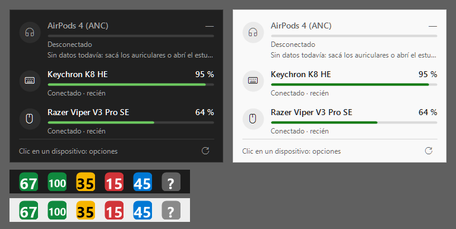

# BatteryTray

App de bandeja para Windows 11 que muestra en un solo lugar la batería de todos los
periféricos inalámbricos: mouse, teclado, auriculares, AirPods y mandos.

- C# / .NET 8 (`net8.0-windows10.0.19041.0`, para usar las APIs WinRT de Bluetooth y Gaming.Input)
- Sin drivers, sin permisos de administrador y sin interferir con Razer Synapse.

## Estado

| Fase | Contenido | Estado |
|------|-----------|--------|
| 0 | Herramienta de diagnóstico (consola) | ✅ |
| 1 | Proveedores: Razer, Apple (AirPods/Beats), mandos, Bluetooth genérico | ✅ |
| 2 | Interfaz de bandeja, autoarranque, notificaciones | ✅ |
| 3 | Investigación: Flydigi, BlackShark V2 Pro Xbox, Keychron 2.4 GHz | pendiente |

## Estructura

```
BatteryTray.sln
Directory.Build.props          configuración común (TFM, nullable, etc.)
src/BatteryTray.App/           fase 2: app de bandeja (WinForms)
src/BatteryTray.Core/          modelo, proveedores, monitor, configuración y log
  Providers/Razer/             protocolo de feature reports de Razer (OpenRazer)
  Providers/Apple/             AirPods/Beats por BLE "proximity pairing"
  Providers/                   mandos (Windows.Gaming.Input) y Bluetooth genérico
tools/BatteryTray.Diag/        fase 0: diagnóstico por consola
tools/BatteryTray.Cli/         fase 1: consola para probar los proveedores
firmware/k8he-sunset/          fase 3c: firmware propio del K8 HE (parche, binario y cómo flashearlo)
tests/BatteryTray.Core.Tests/  tests de los decodificadores (xUnit)
```

## Requisitos

- Windows 10 2004 (19041) o superior; probado en Windows 11.
- [.NET 8 SDK](https://dotnet.microsoft.com/download/dotnet/8.0) para compilar.

## Fase 0 — Diagnóstico

Herramienta de **solo lectura**: enumera dispositivos y propiedades, no envía ningún
comando ni report a los periféricos.

```
dotnet build -c Release
tools\BatteryTray.Diag\bin\Release\net8.0-windows10.0.19041.0\BatteryTray.Diag.exe
```

Opciones:

| Opción | Descripción |
|--------|-------------|
| `--ble <segundos>` | Duración del escaneo BLE (default 15; `0` lo desactiva) |
| `--no-gatt` | No leer el servicio GATT de batería de los dispositivos BLE |
| `--out <archivo>` | Ruta del reporte (default `diag-AAAAMMDD-HHMMSS.txt` en la carpeta actual) |

Secciones del reporte:

1. **HID** (HidSharp): VID/PID, interfaz USB (`MI`), colección (`COL`), usage page/usage,
   largos máximos y IDs de los input/output/feature reports.
2. **USB**: todos los dispositivos USB presentes, aunque no sean HID (receptores XInput,
   audio USB, adaptadores), con su clase y driver.
3. **Bluetooth emparejado**: clásico y LE, estado de conexión, devnodes asociados,
   la propiedad de batería que publica Windows y el servicio GATT Battery (0x180F).
4. **Mandos** (Windows.Gaming.Input): VID/PID y `BatteryReport`.
5. **Escaneo BLE**: advertisements de Apple "proximity pairing" (tipo `0x07`) en crudo,
   para identificar los AirPods.

El reporte incluye direcciones Bluetooth de tus dispositivos; tenelo en cuenta si lo compartís.

## Fase 1 — Proveedores

Cada proveedor cubre una **familia** de dispositivos y devuelve todos los que encuentra,
así la app detecta periféricos nuevos sin tocar código:

| Proveedor | Qué detecta | Cómo |
|-----------|-------------|------|
| Razer (HID) | Cualquier periférico Razer con batería | Feature reports de 90 bytes (protocolo de OpenRazer). Tabla con ~80 PIDs de OpenRazer; los modelos desconocidos se prueban con los transaction IDs conocidos. |
| Apple (BLE) | AirPods y Beats | Escucha los advertisements "proximity pairing" (company ID `0x004C`, tipo `0x07`). Resolución de 10 %. Solo muestra los modelos emparejados con la PC. |
| Mandos | Cualquier mando reconocido por Windows | `Windows.Gaming.Input` → `TryGetBatteryReport()`. Los de Xbox informan en pasos gruesos. |
| Keychron (HID) | Teclados Keychron con el firmware propio (K8 HE "sunset") | Comando raw HID `0xCA` al teclado (cable) o a través del Keychron Link (2.4 GHz). Ver `firmware/k8he-sunset`. |
| Bluetooth (Windows) | Teclados, mouse, auriculares Bluetooth | Propiedad de batería de la pila BT de Windows + servicio GATT Battery (`0x180F`). |

Si un proveedor falla, los demás siguen y sus dispositivos conservan la última lectura.

### Probar

```
dotnet build -c Release
tools\BatteryTray.Cli\bin\Release\net8.0-windows10.0.19041.0\BatteryTray.Cli.exe [--watch] [--wait 10] [-v]
dotnet test
```

### Configuración

`%AppData%\BatteryTray\config.json` (se crea la primera vez). Los logs van a `%AppData%\BatteryTray\logs`.

| Clave | Default | Descripción |
|-------|---------|-------------|
| `pollIntervalSeconds` | 120 | Intervalo de consulta |
| `lowBatteryThreshold` | 20 | Umbral de aviso de batería baja (%) |
| `notifications` | true | Notificación de Windows con batería baja |
| `trayDevice` | null | Id del dispositivo que muestra el ícono (null = el más bajo) |
| `verboseLog` | false | Log detallado |
| `aliases` | `{}` | Nombre propio por id, p. ej. `{ "apple:201B": "Mis AirPods" }` |
| `hiddenDevices` | `[]` | Ids a ocultar |
| `providers.<x>.enabled` | true | Activa/desactiva cada proveedor |
| `providers.razer.probeUnknownDevices` | true | Probar modelos Razer que no están en la tabla |
| `providers.razer.extraDevices` | `[]` | `{ "pid": "0x00XX", "transactionId": "0x1F", "hasCharging": true, "waitMs": 60 }` |
| `providers.apple.onlyPairedModels` | true | Solo modelos emparejados (evita mostrar los AirPods de otros) |
| `providers.apple.minRssi` | -90 | Ignorar señales más débiles (dBm) |
| `providers.keychron.enabled` | true | Teclados Keychron con firmware propio |

Los ids de cada dispositivo se ven en la salida de `BatteryTray.Cli`.

### Créditos

Los datos de protocolo (bytes, offsets y tablas de modelos) se tomaron de
[OpenRazer](https://github.com/openrazer/openrazer) y [CAPod](https://github.com/d4rken-org/capod).
No se copió código.
## Fase 2 — App de bandeja



```
dotnet build -c Release
src\BatteryTray.App\bin\Release\net8.0-windows10.0.19041.0\BatteryTray.exe
```

- **Ícono**: muestra el nivel más bajo (o el dispositivo que elijas) con un color según el nivel:
  verde > 50 %, amarillo ≤ 50 %, rojo ≤ umbral, azul cargando, gris sin datos. El tooltip lista todos.
- **Clic izquierdo**: ventana con todos los dispositivos (nivel, barra, carga, conexión, antigüedad de la
  lectura y partes de los AirPods). Clic en un dispositivo: fijarlo en el ícono, ocultarlo o copiar su id.
- **Clic derecho**: actualizar, elegir qué muestra el ícono, avisos de batería baja, inicio con Windows,
  dispositivos ocultos, abrir configuración y logs.
- **Notificaciones**: una por dispositivo al cruzar el umbral; se vuelve a avisar cuando sube 5 % por encima o se carga.
- **Inicio con Windows**: clave `Run` del usuario (sin administrador). Se registra la ruta actual del `.exe`,
  así que conviene correrlo desde una carpeta fija (por ejemplo, publicándolo con
  `dotnet publish src\BatteryTray.App -c Release -o %LocalAppData%\Programs\BatteryTray`).
- **Configuración**: si editás `config.json` mientras la app corre, se recarga sola.
- Sigue el tema claro/oscuro de Windows y la escala de pantalla.
- `BatteryTray.exe --preview salida.png` guarda una imagen de la ventana con los dispositivos reales.
## Dispositivos identificados

| Dispositivo | Conexión | VID:PID | Notas |
|-------------|----------|---------|-------|
| Razer Viper V3 Pro SE | receptor HyperPolling 2.4 GHz | `1532:00DF` | MI_00 con feature report de 91 B (protocolo Razer) |
| Keychron K8 HE | cable | `3434:0E80` | MI_01: raw HID QMK (`FF60:0061`, 32 B) |
| Keychron K8 HE por 2.4 GHz → Keychron Link | USB | `3434:D030` | MI_03: raw HID (`FF60:0061`); MI_01: page `0x8C` con feature reports de 1000 B |
| AirPods 4 ANC | Bluetooth clásico | BT `004C:201B` | Windows no expone batería; BLE proximity pairing con modelo `0x201B` (bytes `1B 20`) |
| Mando Xbox | Xbox Wireless Adapter `045E:02FE` | `045E:0B12` | `Windows.Gaming.Input` devuelve `BatteryReport` (70 %, descargando) |
| BlackShark V2 Pro Xbox | — | — | pendiente (todavía no lo tengo) |
| Flydigi Vader 5 Pro | — | — | pendiente |
